# Python Problem Solutions

## ## Task 1 
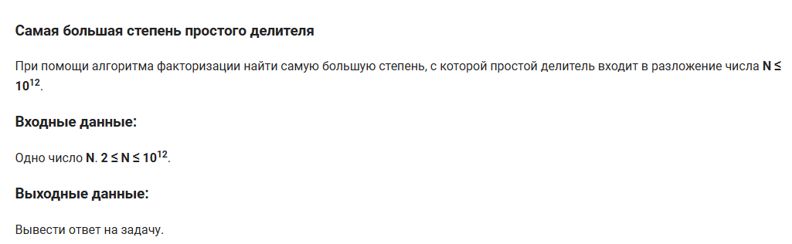

[View Solution Code](task001.py)

## ## Task 2
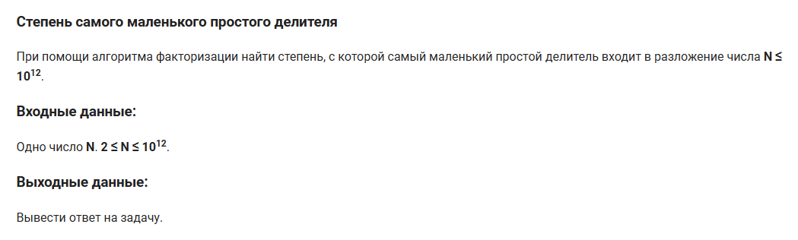

[View Solution Code](task002.py)

## ## Task 3
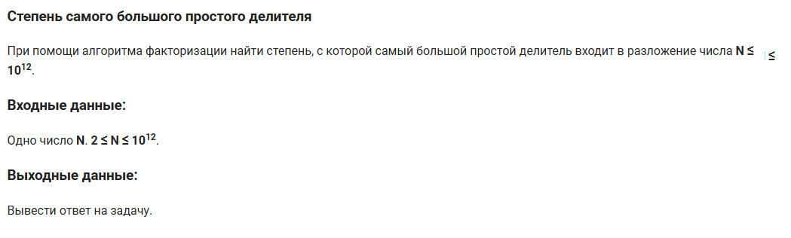

[View Solution Code](task003.py)

## ## Task 4
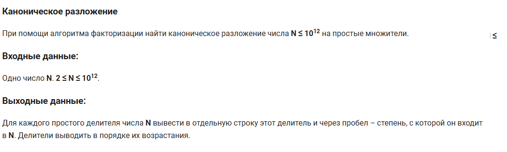

[View Solution Code](task004.py)

## ## Task 5
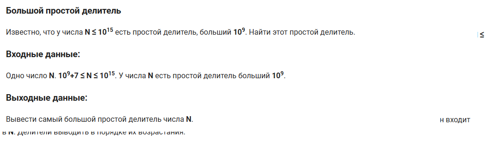

[View Solution Code](task005.py)

## ## Task 6
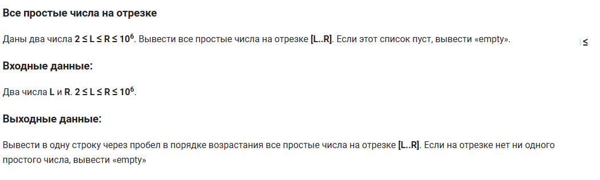

[View Solution Code](task006.py)

## ## Task 7
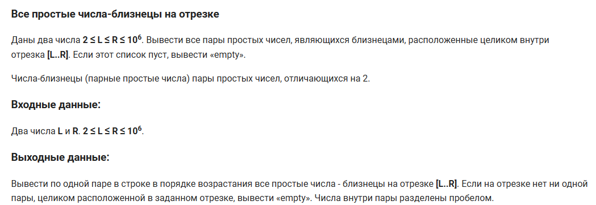

[View Solution Code](task007.py)

## ## Task 8
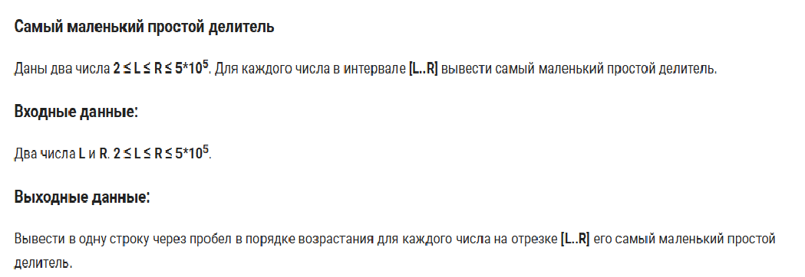

[View Solution Code](task008.py)

## ## Task 9
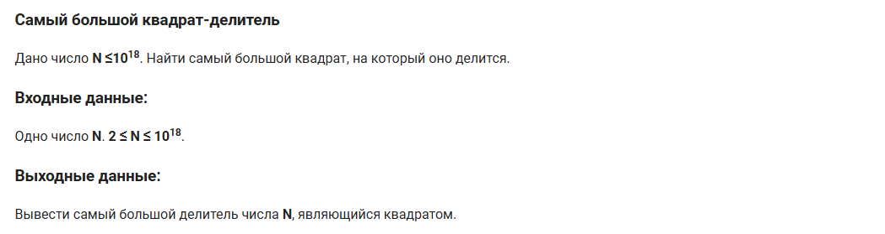

[View Solution Code](task009.py)

## ## Task 10
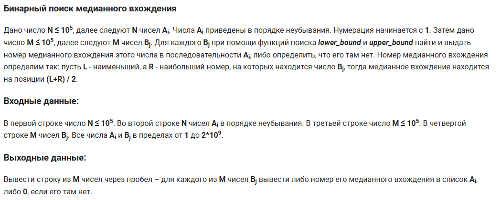

[View Solution Code](task010.py)

## ## Task 11
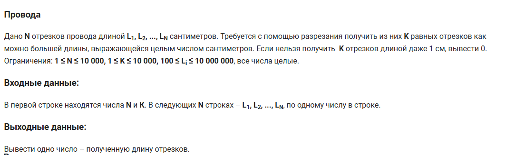

[View Solution Code](task011.py)

## ## Task 12
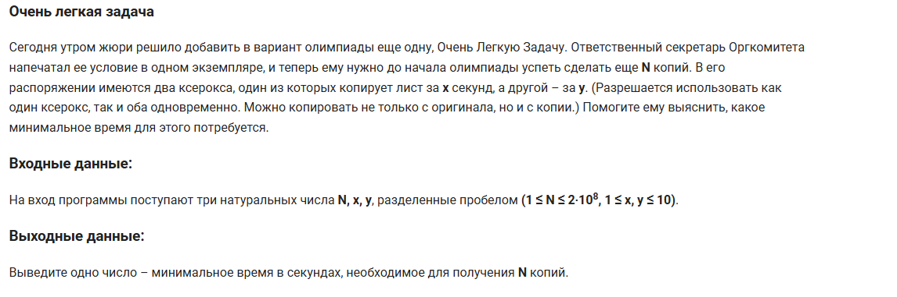

[View Solution Code](task012.py)

## ## Task 13
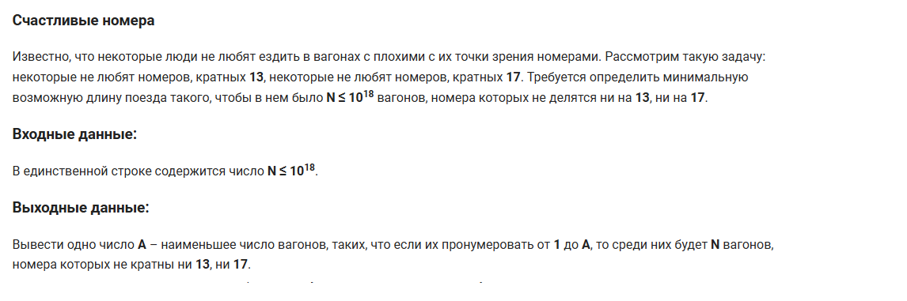

[View Solution Code](task013.py)

## ## Task 14
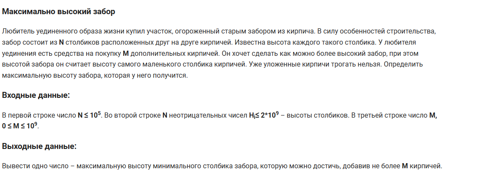

[View Solution Code](task014.py)

## ## Task 15
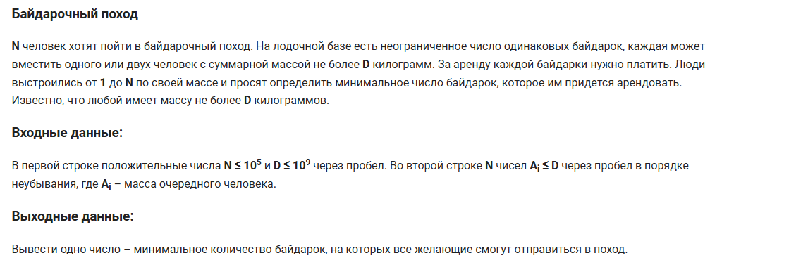

[View Solution Code](task015.py)

## ## Task 16
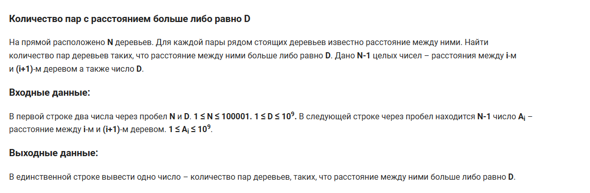

[View Solution Code](task016.py)

## ## Task 17
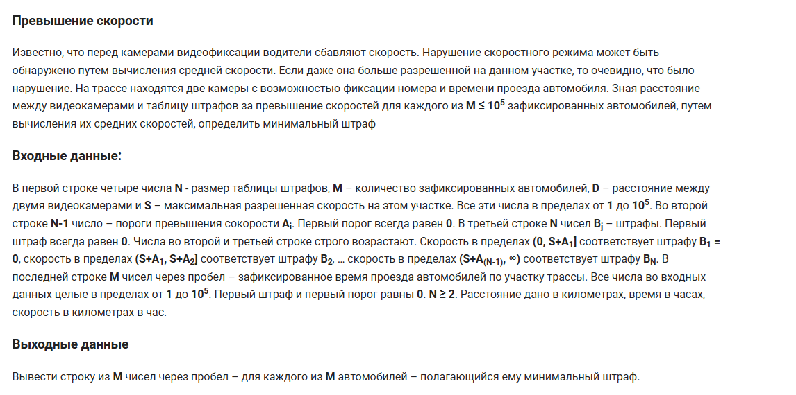

[View Solution Code](task017.py)

## ## Task 18
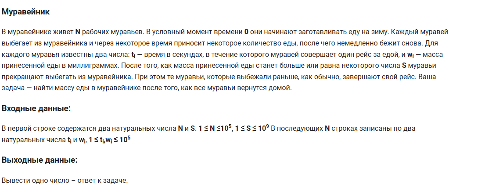

[View Solution Code](task018.py)

## ## Task 19
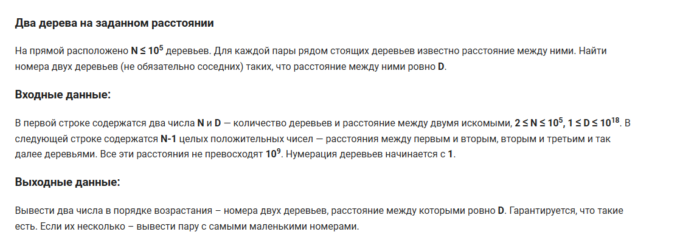

[View Solution Code](task019.py)

## ## Task 20
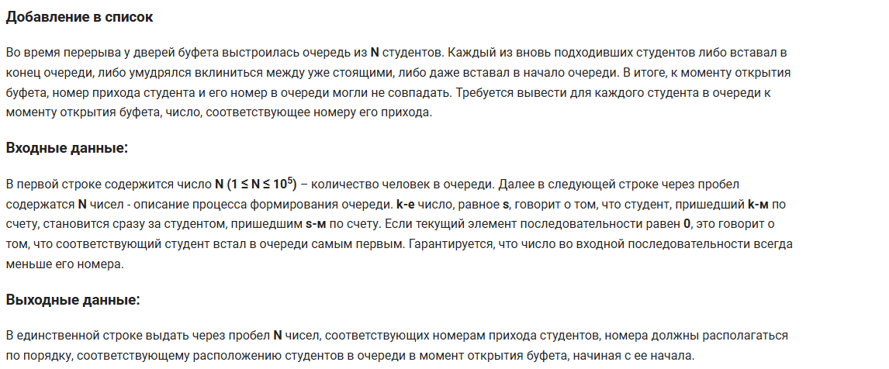

[View Solution Code](task020.py)

## ## Task 21
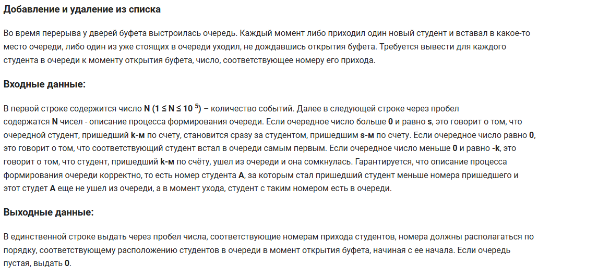

[View Solution Code](task021.py)

## ## Task 22
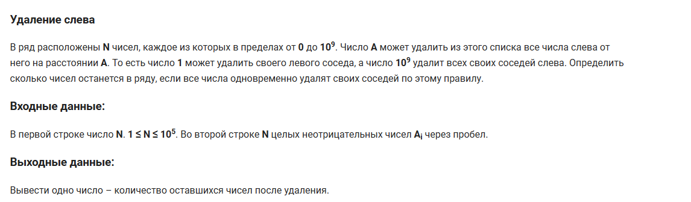

[View Solution Code](task022.py)

## ## Task 23
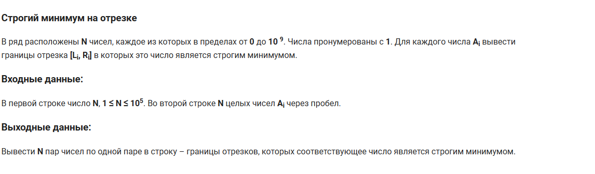

[View Solution Code](task023.py)

## ## Task 24
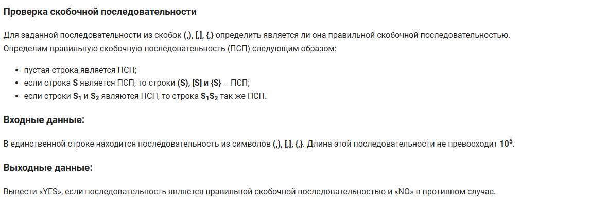

[View Solution Code](task024.py)

## ## Task 25
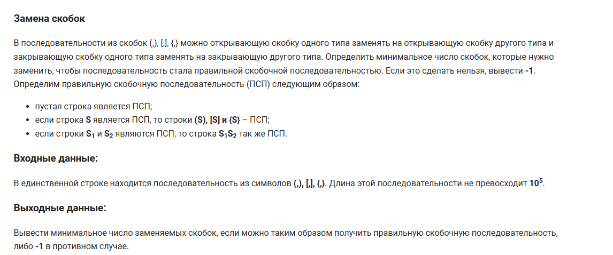

[View Solution Code](task025.py)

